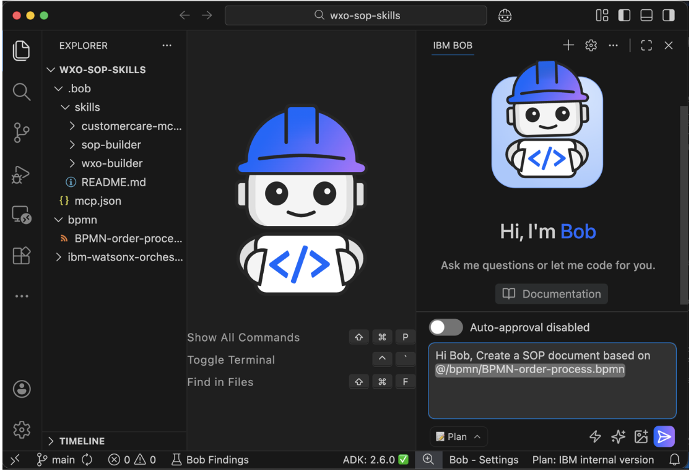

## Create the standard operating procedure document

- Click Start New Task to begin a new task for this step.

Note: Starting new tasks regularly reduces context size and lowers resource usage.

- Make sure that you enable Advanced mode and disable auto-approval. Advanced mode activates Bob skills.

- Create a new folder named bpmn. Download the file BPMN-order-process.bpmn into this folder.
- Provide Bob with instructions to generate the SOP document.
```
Hi Bob, Build a SOP document based on @/bpmn/BPMN-order-process.bpmn
```
```
@section-05/lab04/mermaid/BPMN-order-process.md 을 읽어서  SOP 문서를 lab04/sop/order-processing-sop.md 파일을 생성합니다.
```



Open the document and review the content. The document converts the BPMN workflow into clear business language. You will use the document in later steps to generate a watsonx Orchestrate agent.

The document includes the following sections:

- Executive summary
- Business process flow diagram
- Business context
- Procedure overview
- Data requirements
- Business procedure steps

This document serves as the foundation for implementing an automated order processing agent in watsonx Orchestrate. To view the Mermaid diagrams in the document, install the Mermaid Chart extension.

## Create the agentic workflow from the SOP document
1. Click Start New Task to begin a new task for this step.
2. Keep Advanced mode enabled. Agent(Advanced) mode allows Bob to use Bob skills and access watsonx Orchestrate ADK MCP servers.
3. Provide Bob with the instructions to create the agent. Review the proposed plan and click Approve.
```
Create a watsonx Orchestrate project based on @/bpmn/BPMN-order-process, and this SOP document @/sop/order-processing-sop.md.

 Additional Details:
 - ALWAYS consult the Bob Skill BEFORE writing any watsonx Orchestrate flow or agent code
 - Reference @/ibm-watsonx-orchestrate-adk/examples for proven flow creation patterns (conditional branching, sequential tool chaining)
 - Use the watsonx Orchestrate ADK Documentation MCP server for API references
 - Create new folder `order-processing-agent` for this project
 - Implement with simulated/mock integrations (no external dependencies)
 - Keep business logic in Python tools, not in complex flow expressions.
 - Use automatic mapping when possible instead of complex mapping, and flat field schemas (e.g., `customer_email`) not nested objects (e.g., `customer.email`) to enable automatic mapping.
```

## Deploy the agentic workflow and agent
1. Click Start New Task to begin a new task for this step.
2. Provide Bob with the following instruction to deploy the agent and tools:
```
Run the import script to deploy the flow and agent for  order-processing to my watsonx Orchestrate environment.  
 If there any issues in the import, use Bob skills, watsonx   Orchestrate documentation MCP Server, and example projects for   guidance.  
 Append the console output in a log file  
```

## Run unit tests for the agentic workflow and the agent
1. Click Start New Task 
2. Provide Bob with instructions to run unit tests for the deployed order processing agent and workflow.

```
Please run programmatic unit testing for the watsonx Orchestrate tools and workflow using the existing test file in @/order-processing-agent project. If there are any errors, please fix them, re-import the tools, and retry the tests until successful.

 Additional Details:
 - Before making ANY changes to flow logic, you MUST use the Bob skill "wxo-builder" to consult best practices.
 - Use the watsonx Orchestrate ADK Documentation MCP server when you need specific API references or implementation details
 - When encountering flow-related issues, consult the Bob skill and reference existing flow examples in the @/ibm-watsonx-orchestrate-adk/examples.
 - Read all related files together (tools, flow, test script) before making changes to understand the complete context
```

Instruct Bob to test the deployed agent
```
Hi Bob, using watsonx Orchestrate ADK MCP server, test the agent through chatting with it.

In case there is any issue, fix it, redeploy through the import script, and then iterate again until all issues are fixed.

Finally, create testing summary report for both the agent and the tools in test folder.
```

```
Process an order for customer John Smith (john.smith@example.com) with Order ID: ORD-2024-002, Customer ID: CUST-67890, Phone: +1-555-9876. Items: 1x Gaming Laptop (PROD-003) at $1899.99, 1x Gaming Mouse (PROD-004) at $79.99. Delivery: 456 Oak Avenue, New York, NY 10001, USA. Payment: credit_card
```

# 참조
- (Turn BPMN diagrams into production‑ready agents with Bob skills and watsonx Orchestrate)[https://developer.ibm.com/tutorials/bpmn-to-agents-bob-skills-watsonx-orchestrate/]