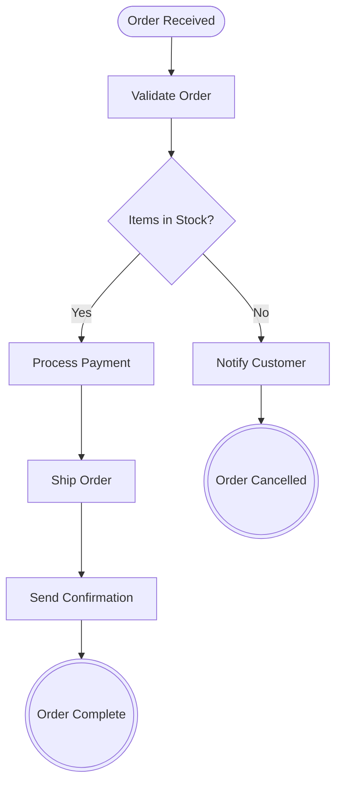

# Order Processing Workflow

BPMN 파일([`section-05/lab04/bpmn/BPMN-order-process.bpmn`](../bpmn/BPMN-order-process.bpmn))을 Mermaid 다이어그램으로 변환한 워크플로우 문서입니다.

## Mermaid Diagram

## Workflow Description

| 단계 | 요소 ID | 유형 | 설명 |
| :--- | :--- | :--- | :--- |
| **시작** | `StartEvent_1` | Start Event | 주문 접수 (`Order Received`) |
| **주문 검증** | `Task_ValidateOrder` | Task | 주문 데이터 및 유효성 확인 (`Validate Order`) |
| **재고 확인** | `Gateway_CheckInventory` | Exclusive Gateway | 재고 유무 분기 (`Items in Stock?`) |
| **결제 처리** | `Task_ProcessPayment` | Service Task | 재고 확인 완료 시 결제 진행 (`Process Payment`) |
| **주문 배송** | `Task_ShipOrder` | Task | 물품 포장 및 배송 처리 (`Ship Order`) |
| **확인 발송** | `Task_SendConfirmation` | Send Task | 고객에게 배송 확인 알림 발송 (`Send Confirmation`) |
| **완료** | `EndEvent_Complete` | End Event | 정상 주문 완료 (`Order Complete`) |
| **고객 안내** | `Task_NotifyOutOfStock` | User Task | 품절 안내 처리 (`Notify Customer`) |
| **취소 완료** | `EndEvent_Cancelled` | End Event | 주문 취소 종료 (`Order Cancelled`) |
