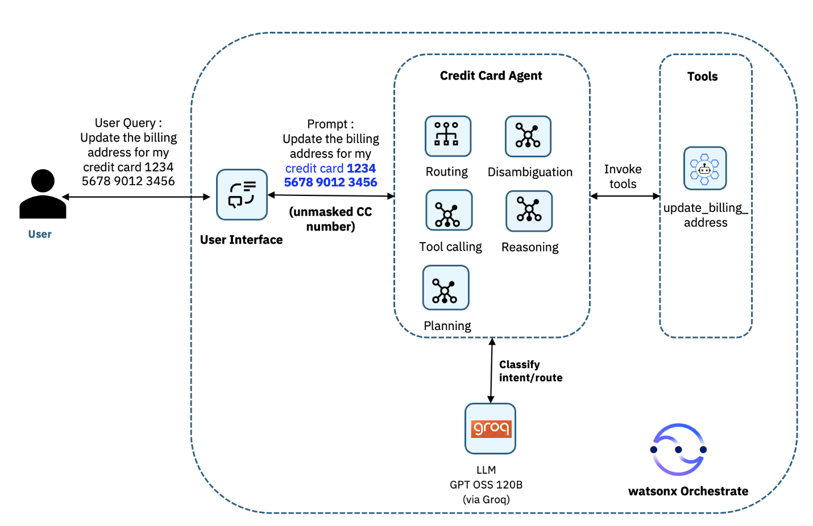
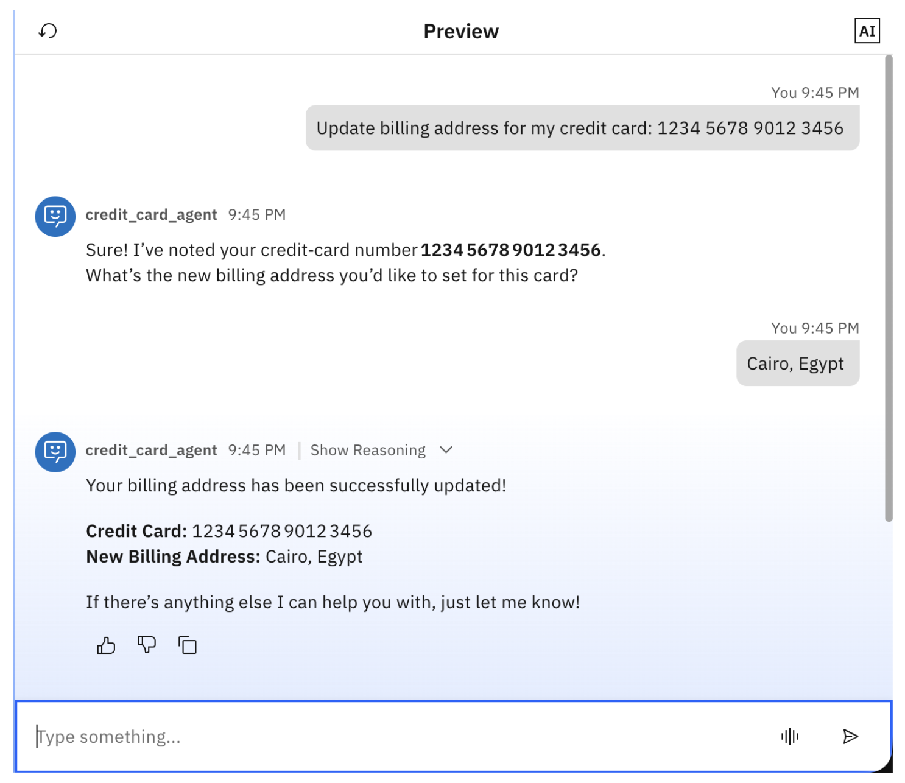
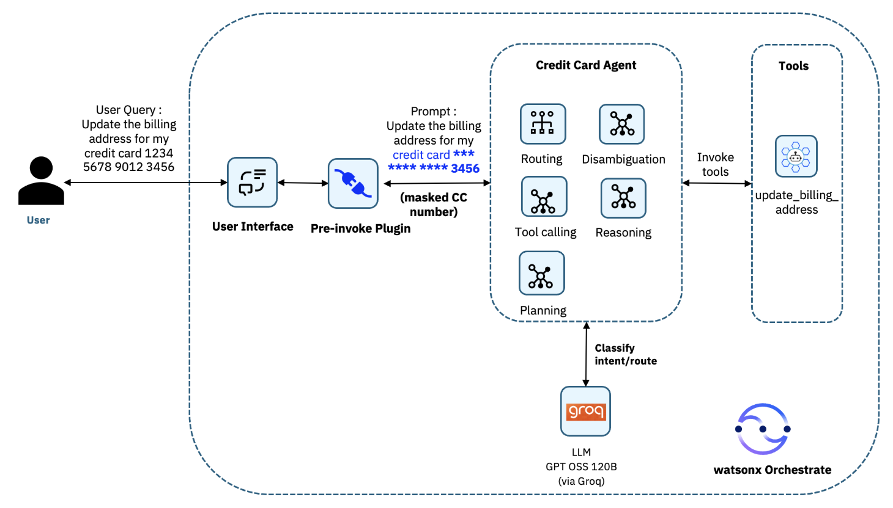
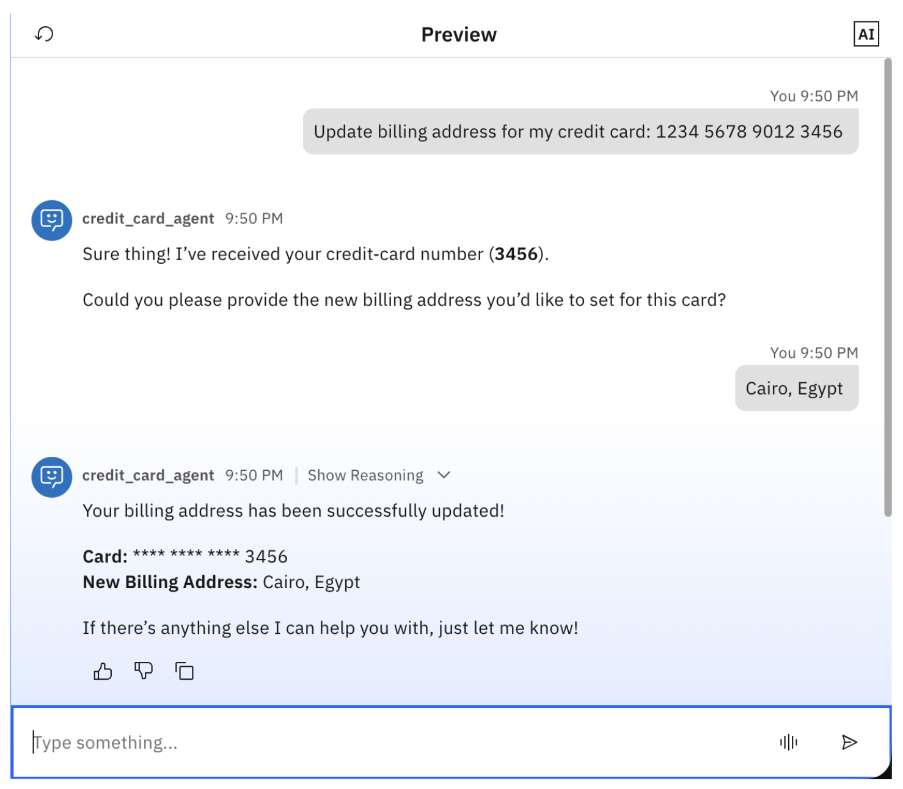

# 개요
개발자는 watsonx Orchestrate 플러그인을 사용하여 Python 기반 미들웨어 함수를 통해 AI 에이전트의 동작을 확장하고 제어합니다. 에이전트가 작업을 수행하기 위해 능동적으로 호출하는 도구와 달리, 플러그인은 에이전트 수명 주기의 주요 지점에서 데이터 흐름을 자동으로 가로챕니다. watsonx Orchestrate는 두 가지 유형의 플러그인을 지원합니다. 바로 ‘pre-invoke 플러그인’(에이전트가 메시지를 처리하기 전에 실행됨)과 ‘post-invoke 플러그인’(에이전트 작업 완료 후 실행됨)입니다.

이 튜토리얼에서는 프리-인보크 플러그인을 사용하여 watsonx Orchestrate에서 에이전트 가드레일을 구현하는 방법을 알아봅니다. 이러한 플러그인은 AI 에이전트가 사용자 메시지를 처리하기 전에 데이터를 가로채어 자동으로 마스킹함으로써 민감한 데이터를 보호할 수 있습니다.

사전 호출 플러그인을 보안 가드레일로 사용하여, 신용카드 번호가 에이전트나 도구로 전달되기 전에 자동으로 마스킹할 수 있습니다. 이 접근 방식을 통해 에이전트 로직이나 도구 구현을 변경할 필요 없이 PCI DSS 준수를 보장하고 안전한 감사 추적을 확보할 수 있습니다.

## AI 에이전트 시스템의 아키텍처

신용카드 에이전트를 구축하게 됩니다. 이 에이전트는 ‘update_billing_address’라는 샘플 watsonx Orchestrate 도구를 통해 사용자가 신용카드 청구지 주소를 업데이트할 수 있도록 지원합니다.

guardrail-credit-card 사전 호출 플러그인을 구현하게 됩니다. 이 플러그인은 사용자 메시지가 에이전트에 도달하기 전에 이를 가로채어, 민감한 데이터를 보호하기 위해 신용카드 번호를 자동으로 가립니다. 이 플러그인은 사용자 인터페이스와 신용카드 에이전트 사이에 위치하여, 전체 신용카드 번호가 에이전트의 추론용 LLM이나 update_billing_address 도구로 절대 전달되지 않도록 보장합니다.

실제 은행 및 결제 환경에서 백엔드 시스템은 업데이트를 수행하는 데 전체 신용카드 번호가 필요하지 않은 경우가 많습니다. 시스템은 올바른 계정을 고유하게 식별할 수 있는 정보만 있으면 되는데, 일반적으로는 마지막 네 자리 번호와 인증된 사용자 정보를 결합한 형태입니다. 사용자는 이미 로그인한 상태이므로, 시스템은 사용자의 신원과 관련 카드 정보를 이미 파악하고 있습니다.

사용자가 실수로 자연어 형태로 전체 신용카드 번호를 입력한 경우, 이를 LLM에 노출시키는 것은 불필요할 뿐만 아니라 위험합니다. 따라서 watsonx Orchestrate 사전 호출 플러그인은 에이전트가 전체 신용카드 번호를 절대 볼 수 없도록 보장하면서도, 백엔드에서 정당한 목적으로 요구하는 번호의 일부만 도구가 수신할 수 있도록 함으로써 필수적인 안전장치 역할을 합니다. 이러한 접근 방식은 PCI 규제를 받는 민감한 데이터를 보호하고, LLM의 노출 범위를 줄이며, 사용자 경험을 저해하지 않으면서도 올바른 비즈니스 기능을 유지합니다.

**pre-invoke 플러그인이 없는 아키텍처**
프리-인보크 플러그인을 구현하기 전에, 에이전트는 전체 신용카드 정보를 수신한 후, 다음 아키텍처에 표시된 대로 해당 정보를 도구로 전달합니다.



그리고 이것이 WatsonX Orchestrate에서 보이는 모습입니다.



**pre-invoke 플러그인을 사용한 아키텍처**

orchestrate tools import -k python -f update_credit_card.py





## Steps
These are the steps you are going to follow in this tutorial:

1. Create the tool
2. Create the pre-invoke plug-in
3. Create the agent
4. Test the agent
   
### Step 1. Create the tool
이 단계에서는 신용카드 청구지 주소 변경을 시뮬레이션하는 도구를 만들게 됩니다.  


> 개발자 파트너로 활동 중인 IBM Bob의 도움을 받아 생성된 샘플 도구 코드(update_credit_card.py)를 검토하고, 이를 로컬에 다운로드하십시오.

update_billing_address 도구는 신용카드 계정의 청구지 주소를 업데이트하는 Python 기반 watsonx Orchestrate 도구입니다. 이 도구는 credit_card_number와 billing_address라는 두 가지 매개변수를 입력으로 받습니다. 에이전트가 이 도구를 호출하면, 도구는 두 입력값이 비어 있지 않은지 유효성을 확인한 후, 작업 상태, 성공 메시지, 신용카드 번호, 새로운 청구지 주소 및 타임스탬프가 포함된 JSON 응답을 반환합니다. 이 구현은 시뮬레이션 목적으로만 사용되며, 일반적인 시나리오에서는 도구가 실제 결제 처리 시스템이나 핵심 뱅킹 백엔드에 연결하여 업데이트를 수행합니다.

> Import the tool in watsonx Orchestrate.
```bash
orchestrate tools import -k python -f update_credit_card.py
```
### Step 2. Create the pre-invoke plug-in
이 단계에서는 에이전트가 사용자 메시지를 처리하기 전에 이를 가로채고, 신용카드 번호가 AI 에이전트나 도구에 도달하기 전에 자동으로 가리는 보안 장벽 역할을 하는 프리-인보크 플러그인을 만들게 됩니다.

> Bob의 도움을 받아 생성된 프리-인보크 플러그인 코드(guardrail_cc_preinvoke.py)를 검토하고, 이를 로컬에 다운로드하십시오.

guardrail_cc_preinvoke 플러그인은 watsonx Orchestrate의 사전 호출(pre-invoke) 플러그인으로, 사용자 메시지를 추출하고 정규 표현식 패턴을 적용하여 신용카드 번호를 식별한 후, 마지막 네 자리 숫자를 제외한 나머지 부분을 별표로 대체하여 가림 처리합니다. 그런 다음 이 플러그인은 가림 처리된 텍스트로 메시지 페이로드를 업데이트하고, 정제된 메시지를 에이전트에 전달합니다.

> Import the plug-in in watsonx Orchestrate.
 
```bash
orchestrate tools import -k python -f guardrail_cc_preinvoke.py
```

### Step 3. Create the agent
이 단계에서는 이전 단계에서 만든 도구와 플러그인을 사용하는 신용카드 에이전트를 생성합니다.

> Bob의 도움을 받아 생성한 에이전트 YAML 구성 파일(credit_card_agent.yaml)을 검토하고, 이를 로컬에 다운로드하십시오.

이 에이전트는 사용자가 신용카드 청구지 주소를 업데이트할 수 있도록 도와줍니다. 이 에이전트는 Groq LLM(GPT-OSS-120B)을 사용하며, 앞서 생성한 update_billing_address 도구를 포함하여 실제 업데이트 작업을 수행합니다. 에이전트는 먼저 신용카드 정보 수신을 확인한 후, 새로운 청구지 주소를 요청하고, 해당 도구를 사용하여 업데이트를 처리한 다음, 성공 여부를 확인해 줍니다.

가장 중요한 점은, 이 에이전트의 사전 호출(pre-invoke) 구성에 guardrail_cc_preinvoke 플러그인이 설정되어 있어, 에이전트에 요청이 도달하기 전에 이 플러그인이 자동으로 호출된다는 것입니다. 이를 통해 에이전트와 도구는 사용자가 제공한 신용카드 번호 중 마지막 네 자리만 볼 수 있도록 보장됩니다.

중요: 다음 이미지에 강조 표시된 대로 YAML 구성에서 plugins.agent_pre_invoke를 추가하여 플러그인 세부 정보를 설정할 수 있도록, 사용자 인터페이스를 통해 직접 생성하지 말고 반드시 YAML 구성을 통해 에이전트를 생성해야 합니다.

> Import the agent in watsonx Orchestrate.
```bash
orchestrate agents import -f credit_card_agent.yaml
```

> Verify that the agent is imported correctly with the tool and plug-in.
```bash
orchestrate agents list
```

### Step 4. Test the watsonx Orchestrate agent

> watsonx Orchestrate에 로그인합니다. ‘에이전트 관리(Manage Agents)’로 이동하여 “credit_card_agent”라는 이름의 에이전트를 검색합니다

> 도구가 에이전트에 추가되었는지 확인하고 에이전트의 동작을 검토하십시오.


> 다음 명령어를 입력하여 에이전트를 테스트해 보세요: “내 신용카드(1234 5678 9012 3456)의 청구지 주소를 업데이트해 주세요”, 그런 다음 에이전트가 청구지 주소를 묻는다면 임의의 청구지 주소(예: 이집트 카이로)를 입력하세요.


## 참조
- [Implement agent guardrails with watsonx Orchestrate plug-ins](https://developer.ibm.com/tutorials/ai-agents-guardrails-watsonx-orchestrate-plugins/)